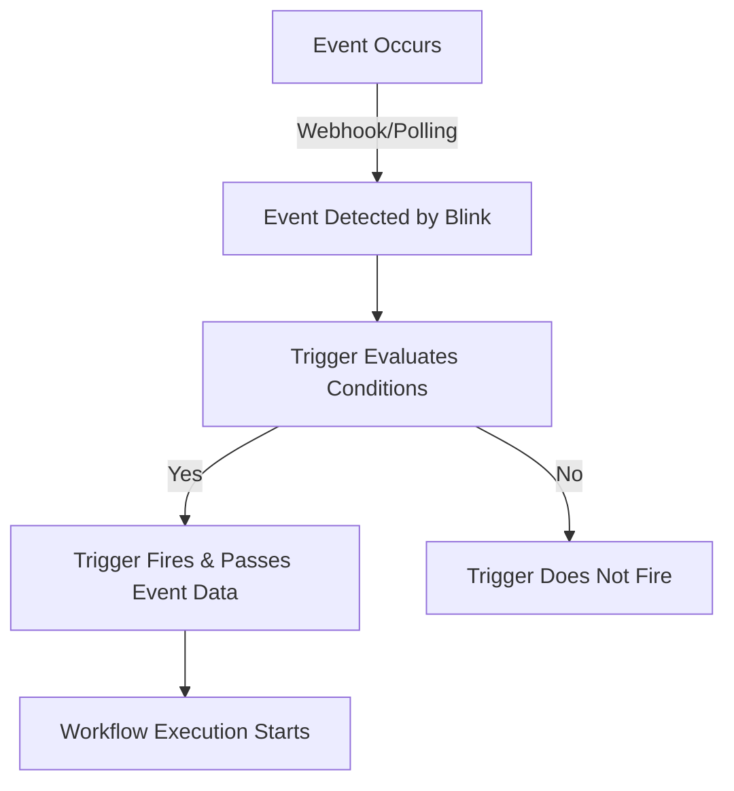

> ## Documentation Index
> Fetch the complete documentation index at: https://docs.blinkops.com/llms.txt
> Use this file to discover all available pages before exploring further.

# Using Event-Based Triggers

> Configure event-based triggers that start workflows automatically in response to external events.

<Card title="How this Helps" icon="lightbulb">
  Event-based workflows are particularly useful for real-time automation, enabling workflows to respond to security threats, update records, or manage service incidents without manual intervention.
</Card>

You can configure workflows to start automatically when a specified <Tooltip tip="Event-based triggers allow workflows to initiate in response to specific occurrences.">event</Tooltip> occurs.

<Note>
  Need help finding the right trigger type for your use case? See [About Triggers](/docs/workflows/building-workflows/triggers/triggers).
</Note>

<Accordion title="Prerequisites" icon="list-check">
  Prerequisites vary depending on the kind of workflow you're building.

  For flows triggered by a Blink [connection](/docs/workflows/building-workflows/connections/connections) to an external service, you'll need the necessary permissions with the external vendor in order to establish a Blink connection with that external service.

  For flows triggered by a Blink service, such as Blink Events or Case Management, and for custom webhooks, see the related documentation:

  * [Custom Webhooks](/docs/workflows/building-workflows/triggers/event-based-triggers/webhooks)
  * [Blink Error Event](/docs/workflows/building-workflows/error-handling/run-error#creating-an-event-based-workflow-using-the-blink-error-event)
  * [Blink Runner Notification](/docs/blink-platform/runners/runners-settings#how-to-set-up-a-runner-notification-workflow)
  * [Case Management](/docs/case-management/case-management)
</Accordion>

## Event Types

Blink supports multiple event-based triggers, including:

<div className="integrations-table">
  | **Trigger Type** | **Description** |
  | - | - |
  | **External event triggers** | Events triggered by third-party integrations. |
  | **[Custom Webhooks](/docs/workflows/building-workflows/triggers/event-based-triggers/webhooks)** | User-defined webhooks that trigger workflows. |
  | **[Web Forms](/docs/blink-platform/web-form/web-form)** | Create and share a secure, interactive web page designed to gather input. |
  | **Native Blink events** | Built-in events generated within Blink. |
  | **[Case Management](/docs/case-management/case-management)** events | Events associated with case tracking and management. |
</div>

<Accordion title="Example" icon="magnifying-glass-plus">
  *For example*, using an event-based trigger, you can trigger a workflow:

  * An Okta webhook event sent on specified alerts, for example for password resets
  * A Splunk New Query Search Event that is triggered for critical alerts (polling trigger)
  * A Jira New Issue event triggered according to workflow conditions (polling trigger)
  * A Blink web form event containing a security incident report
</Accordion>

You can configure triggers based on [external vendor events](#external-event-triggers), [integrating](/docs/integrations/integrations) third-party services into your automated workflows. This enables your workflows to respond dynamically to external system updates, ensuring seamless automation across your tech stack.

By combining [Blink system events](#blink-events) with external vendor events, you can create workflows that respond efficiently to the most critical updates, optimizing your automation processes.

<Note>
  The remainder of this article describes [External Event Triggers](#external-event-triggers), [polling](#about-polling), and [how to configure an event-based trigger](#configure-an-event-based-trigger).

  Configuring webhook triggers is detailed in [Configuring Event-Based Triggers with Webhooks](/docs/workflows/building-workflows/triggers/event-based-triggers/webhooks).

  Learn more about Case Management [here](/docs/case-management/case-management).
</Note>

### Blink Events

Blink offers built-in event triggers that help manage workflow execution and system monitoring. These include:

* **[Blink Error Event](/docs/workflows/building-workflows/error-handling/run-error#creating-an-event-based-workflow-using-the-blink-error-event)**: Used for handling workflow failures, allowing you to trigger another workflow to respond to errors. The error event payload contains details about the failure, ensuring you can design an appropriate response.
* **[Tables](/docs/blink-platform/tables/tables-in-workflows)** - Used to trigger the workflow when the specified Blink table receives a new record or when an existing record is updated.
* **[Blink Runner Notification](/docs/blink-platform/runners/runners-settings#how-to-set-up-a-runner-notification-workflow)**: Enables notifications for runner-related events:
  * Runner has been disconnected - triggered when the runner has been offline for more than 10 minutes.
  * Runner failed to upgrade - triggered when auto upgrade is *enabled* but failed
  * Runner outdated - triggered when auto upgrade is *disabled* and a new version is released

<Note>
  See [Blink Error Event](/docs/workflows/building-workflows/error-handling/run-error#creating-an-event-based-workflow-using-the-blink-error-event) and [Blink Runner Notification](/docs/blink-platform/runners/runners-settings#how-to-set-up-a-runner-notification-workflow) for more information about Blink Events.
</Note>

### External Event Triggers

Blink provides trigger events from external vendors, which are available in the list of event trigger options. These events are based on the cloud services offered by each vendor and cannot be modified.

Many vendors use [polling](#about-polling) to detect changes, while others support webhooks—or a combination of both.

Selecting the right event trigger allows your workflows to proactively handle errors, system changes, and third-party events, enhancing both efficiency and reliability.

<Tip>
  * Consult the documentation for the relevant external vendor to learn more about their services.
  * To use a custom trigger, see [Configuring Event-Based Triggers with Webhooks](/docs/workflows/building-workflows/triggers/event-based-triggers/webhooks).
</Tip>

<Note>
  The rest of this article explains how to configure event-based triggers with any available Blink connection, focusing primarily on events that **do not include** webhook configuration.

  For detailed information, use cases, and instructions about webhooks, see [Configuring Event-Based Triggers with Webhooks](/docs/workflows/building-workflows/triggers/event-based-triggers/webhooks).
</Note>

## About Polling

For most predefined trigger events, Blink relies on polling to periodically check the external vendor system for updates at fixed intervals. This ensures that workflows stay up to date routinely. The polling interval defines how often Blink scans for new events, acting as a timer to ensure timely responses and efficient automation.

<Warning>
  Polling in Blink runs on a fixed schedule (every X minutes or seconds). Each time a poll executes, it retrieves the data as it exists at that moment. It does not fetch data in real-time or at the exact moment an external event originally happened.

  **Important:** If multiple actions occur within the same polling interval, only the data retrieved at the next scheduled poll will be available. Any changes that happen between polls will not be reflected until the following polling cycle.

  **Recommendation:** For workflows that depend on the most current data, try to separate critical actions so they run in different polling intervals. When possible, prefer triggers that provide real-time updates instead of relying solely on polling.
</Warning>

When Blink receives an event, it processes the event payload, which contains the data sent by the event source. Each payload includes:

* The event type
* The event source
* All relevant information about the event, such as timestamps, identifiers, and any other pertinent data fields provided by the external vendor system

This data is then used to trigger the configured workflow, allowing you to automate responses based on the specific details of the event.

If multiple new scans are detected in a single polling cycle, Blink treats each scan as an individual event, triggering the workflow separately for each one. This ensures that every detected scan is processed independently, preventing any data loss even when multiple scans are received at once.

<Warning> Your workflow should be designed to handle **a single event per execution**, as Blink triggers the workflow separately for each detected event. </Warning>

<Accordion title="Example" icon="magnifying-glass-plus">
  **Checkmarx scans**

  If a workflow is triggered by new scans in Checkmarx, Blink polls the **Checkmarx New Scan** endpoint at the configured interval to check for new scan events. If multiple new scans are detected in a single polling cycle, Blink processes each scan as a separate event, triggering the workflow multiple times—once for each scan. Blink then executes the workflow separately for each event.

  **Gmail messages**

  If a workflow is triggered by a new email in Gmail, Blink polls the Gmail New Message API endpoint at the configured interval to check for new email messages. The payload might include the sender's email address, the subject line, and the body of the email. Blink uses this information to execute the workflow steps you have defined, such as forwarding the email, creating a task, or sending a notification.
</Accordion>

## How Event-Based Triggers Work

Event-based triggers allow workflows to start automatically when a specified event occurs. These events can come from Blink’s internal system, third-party services, or custom webhooks. By configuring event-based triggers, you can automate responses to system changes, security alerts, or operational events in real time.

The following diagram illustrates how event-based triggers work, from event detection to workflow execution:



<Steps>
  <Step title="An Event Occurs">
    This could be a system-generated event, an update from a third-party service, or an external webhook call.
  </Step>

  <Step title="Blink Detects the Event">
    Depending on the trigger type, Blink either receives a webhook payload or retrieves event data as a payload through polling at scheduled intervals.
  </Step>

  <Step title="Trigger Conditions are Evaluated">
    Blink checks if the event matches the configured trigger conditions. If the conditions are met, the event proceeds to the next step.
  </Step>

  <Step title="Trigger Fires & Passes Event Data">
    The workflow receives relevant event details, including timestamps, identifiers, and metadata.

    <Accordion title="Payload Example for a Polling Event-Based Trigger" icon="code-simple">
      ```sh theme={"dark"}
      {
          "hook": {
              "active": true,
              "config": {
                  "content_type": "form",
                  "insecure_ssl": "0",
                  "secret": "********",
                  "url": "https://blinkappdev-app.blinkops.com/webhooks/b7b90d07-0a10-498e-879d-0cad973a262c?apikey=9c4654dc04c046fd965sdkljf8977212ba"
              },
              "created_at": "2025-02-27T18:40:02Z",
              "deliveries_url": "https://api.github.com/repos/mygithubuser/myawesomerepo/hooks/532494700/deliveries",
              "events": [
                  "push"
              ],
              "id": 532494700,
              "last_response": {
                  "code": null,
                  "message": null,
                  "status": "unused"
              },
              "name": "web",
              "ping_url": "https://api.github.com/repos/mygithubuser/myawesomerepo/hooks/532494700/pings",
              "test_url": "https://api.github.com/repos/mygithubuser/myawesomerepo/hooks/532494700/test",
              "type": "Repository",
              "updated_at": "2025-02-27T18:40:02Z",
              "url": "https://api.github.com/repos/mygithubuser/myawesomerepo/hooks/532494700"
          },
          "hook_id": 532494700,
          "repository": {
              "allow_forking": true,
              "archive_url": "https://api.github.com/repos/mygithubuser/myawesomerepo/{archive_format}{/ref}",
              "archived": false,
              "assignees_url": "https://api.github.com/repos/mygithubuser/myawesomerepo/assignees{/user}",
              "blobs_url": "https://api.github.com/repos/mygithubuser/myawesomerepo/git/blobs{/sha}",
              "branches_url": "https://api.github.com/repos/mygithubuser/myawesomerepo/branches{/branch}",
              "clone_url": "https://github.com/mygithubuser/myawesomerepo.git",
              "collaborators_url": "https://api.github.com/repos/mygithubuser/myawesomerepo/collaborators{/collaborator}",
              "comments_url": "https://api.github.com/repos/mygithubuser/myawesomerepo/comments{/number}",
              "commits_url": "https://api.github.com/repos/mygithubuser/myawesomerepo/commits{/sha}",
              "compare_url": "https://api.github.com/repos/mygithubuser/myawesomerepo/compare/{base}...{head}",
              "contents_url": "https://api.github.com/repos/mygithubuser/myawesomerepo/contents/{+path}",
              "contributors_url": "https://api.github.com/repos/mygithubuser/myawesomerepo/contributors",
              "created_at": "2021-01-03T18:41:54Z",
              "default_branch": "dependabot/npm_and_yarn/types/node-14.14.16",
              "deployments_url": "https://api.github.com/repos/mygithubuser/myawesomerepo/deployments",
              "description": null,
              "disabled": false,
              "downloads_url": "https://api.github.com/repos/mygithubuser/myawesomerepo/downloads",
              "events_url": "https://api.github.com/repos/mygithubuser/myawesomerepo/events",
              "fork": false,
              "forks": 0,
              "forks_count": 0,
              "forks_url": "https://api.github.com/repos/mygithubuser/myawesomerepo/forks",
              "full_name": "mygithubuser/myawesomerepo",
              "git_commits_url": "https://api.github.com/repos/mygithubuser/myawesomerepo/git/commits{/sha}",
              "git_refs_url": "https://api.github.com/repos/mygithubuser/myawesomerepo/git/refs{/sha}",
              "git_tags_url": "https://api.github.com/repos/mygithubuser/myawesomerepo/git/tags{/sha}",
              "git_url": "git://github.com/mygithubuser/myawesomerepo.git",
              "has_discussions": false,
              "has_downloads": true,
              "has_issues": true,
              "has_pages": true,
              "has_projects": true,
              "has_wiki": true,
              "homepage": null,
              "hooks_url": "https://api.github.com/repos/mygithubuser/myawesomerepo/hooks",
              "html_url": "https://github.com/mygithubuser/myawesomerepo",
              "id": 326476666,
              "is_template": false,
              "issue_comment_url": "https://api.github.com/repos/mygithubuser/myawesomerepo/issues/comments{/number}",
              "issue_events_url": "https://api.github.com/repos/mygithubuser/myawesomerepo/issues/events{/number}",
              "issues_url": "https://api.github.com/repos/mygithubuser/myawesomerepo/issues{/number}",
              "keys_url": "https://api.github.com/repos/mygithubuser/myawesomerepo/keys{/key_id}",
              "labels_url": "https://api.github.com/repos/mygithubuser/myawesomerepo/labels{/name}",
              "language": "TypeScript",
              "languages_url": "https://api.github.com/repos/mygithubuser/myawesomerepo/languages",
              "license": {
                  "key": "mit",
                  "name": "MIT License",
                  "node_id": "MDc6TGljZW5zZTEz",
                  "spdx_id": "MIT",
                  "url": "https://api.github.com/licenses/mit"
              },
              "merges_url": "https://api.github.com/repos/mygithubuser/myawesomerepo/merges",
              "milestones_url": "https://api.github.com/repos/mygithubuser/myawesomerepo/milestones{/number}",
              "mirror_url": null,
              "name": "myawesomerepo",
              "node_id": "MDEwOlJlcG9zaXRvcnkzMjY0NzY2NjY=",
              "notifications_url": "https://api.github.com/repos/mygithubuser/myawesomerepo/notifications{?since,all,participating}",
              "open_issues": 19,
              "open_issues_count": 19,
              "owner": {
                  "avatar_url": "https://avatars.githubusercontent.com/u/13101827?v=4",
                  "events_url": "https://api.github.com/users/mygithubuser/events{/privacy}",
                  "followers_url": "https://api.github.com/users/mygithubuser/followers",
                  "following_url": "https://api.github.com/users/mygithubuser/following{/other_user}",
                  "gists_url": "https://api.github.com/users/mygithubuser/gists{/gist_id}",
                  "gravatar_id": "",
                  "html_url": "https://github.com/mygithubuser",
                  "id": 13101827,
                  "login": "mygithubuser",
                  "node_id": "MDQ6VXNlcjEzMTAxODI3",
                  "organizations_url": "https://api.github.com/users/mygithubuser/orgs",
                  "received_events_url": "https://api.github.com/users/mygithubuser/received_events",
                  "repos_url": "https://api.github.com/users/mygithubuser/repos",
                  "site_admin": false,
                  "starred_url": "https://api.github.com/users/mygithubuser/starred{/owner}{/repo}",
                  "subscriptions_url": "https://api.github.com/users/mygithubuser/subscriptions",
                  "type": "User",
                  "url": "https://api.github.com/users/mygithubuser",
                  "user_view_type": "public"
              },
              "private": false,
              "pulls_url": "https://api.github.com/repos/mygithubuser/myawesomerepo/pulls{/number}",
              "pushed_at": "2023-01-07T22:52:28Z",
              "releases_url": "https://api.github.com/repos/mygithubuser/myawesomerepo/releases{/id}",
              "size": 32926,
              "ssh_url": "git@github.com:mygithubuser/myawesomerepo.git",
              "stargazers_count": 0,
              "stargazers_url": "https://api.github.com/repos/mygithubuser/myawesomerepo/stargazers",
              "statuses_url": "https://api.github.com/repos/mygithubuser/myawesomerepo/statuses/{sha}",
              "subscribers_url": "https://api.github.com/repos/mygithubuser/myawesomerepo/subscribers",
              "subscription_url": "https://api.github.com/repos/mygithubuser/myawesomerepo/subscription",
              "svn_url": "https://github.com/mygithubuser/myawesomerepo",
              "tags_url": "https://api.github.com/repos/mygithubuser/myawesomerepo/tags",
              "teams_url": "https://api.github.com/repos/mygithubuser/myawesomerepo/teams",
              "topics": [],
              "trees_url": "https://api.github.com/repos/mygithubuser/myawesomerepo/git/trees{/sha}",
              "updated_at": "2021-01-03T18:48:03Z",
              "url": "https://api.github.com/repos/mygithubuser/myawesomerepo",
              "visibility": "public",
              "watchers": 0,
              "watchers_count": 0,
              "web_commit_signoff_required": false
          },
          "sender": {
              "avatar_url": "https://avatars.githubusercontent.com/u/13101827?v=4",
              "events_url": "https://api.github.com/users/mygithubuser/events{/privacy}",
              "followers_url": "https://api.github.com/users/mygithubuser/followers",
              "following_url": "https://api.github.com/users/mygithubuser/following{/other_user}",
              "gists_url": "https://api.github.com/users/mygithubuser/gists{/gist_id}",
              "gravatar_id": "",
              "html_url": "https://github.com/mygithubuser",
              "id": 13101827,
              "login": "mygithubuser",
              "node_id": "MDQ6VXNlcjEzMTAxODI3",
              "organizations_url": "https://api.github.com/users/mygithubuser/orgs",
              "received_events_url": "https://api.github.com/users/mygithubuser/received_events",
              "repos_url": "https://api.github.com/users/mygithubuser/repos",
              "site_admin": false,
              "starred_url": "https://api.github.com/users/mygithubuser/starred{/owner}{/repo}",
              "subscriptions_url": "https://api.github.com/users/mygithubuser/subscriptions",
              "type": "User",
              "url": "https://api.github.com/users/mygithubuser",
              "user_view_type": "public"
          },
          "zen": "Encourage flow."
      }
      ```
    </Accordion>
  </Step>

  <Step title="Workflow Executes">
    Automated actions run based on the workflow logic.
  </Step>
</Steps>

## Configure an Event-Based Trigger

**To configure an event-based trigger using a vendor connection or a Blink Event:**

1. [Create a new workflow](/docs/workflows/creating-a-workflow), and select **Event-based Workflow** when prompted.

   <Frame>
     
   </Frame>

   Once you click Create Workflow, the canvas loads with your initial configurations. The first part of the workflow is **Trigger: Event-Based**.

2. Click **Click to select an event**.<br />The **Trigger Setup** popup opens.

   <Frame>
     
   </Frame>

3. Select an option from the list. The right panel opens with supported events for the selected connection.

   <Note>
     This example demonstrates a polling event. To configure webhook events, see [Configuring Triggers with Webhooks](/docs/workflows/building-workflows/triggers/event-based-triggers/webhooks) for additional guidance.
   </Note>

4. From the right panel, select a supported out-of-the-box event (any event that is not a Webhook) and click **Continue**. The **Trigger Setup** popup loads all relevant parameters based on the event you chose.

   <Frame>
     
   </Frame>

5. *Optionally* click **View** next to **Sample event**.

   A popup opens with a sample event <Tooltip tip="The data sent by the event source.">payload</Tooltip>.

   <Tip>
     Use the sample event payload to understand the data structure and fields available for your workflow.
   </Tip>

6. From the **Connection** dropdown, select an existing connection or [create a new connection](/docs/workflows/building-workflows/connections/creating-connection).

   <Frame>
     
   </Frame>

7. Configure all mandatory parameters.

   <Tip>
     Parameters are determined based on the source service and the event you selected. For assistance with any of the parameters, refer to the API documentation for the source service.
   </Tip>

   For polling, the default interval is set to 5 minutes which can be adjusted accordingly.

   *Optionally*:

   * Open the **Advanced** accordion to configure additional parameters
   * Toggle **Add condition** to define conditions for the trigger.

     See [Condition Builder](/docs/blink-platform/interface-components/condition-builder) for more details.

   <Frame>
     
   </Frame>

8. Click **Apply**.

   The **Trigger Setup** popup closes and the trigger configuration is saved. Once you finish building the workflow and publish it, the workflow is triggered when the trigger event occurs and the conditions are met.

   <Frame>
     
   </Frame>

## **Related Articles**

<CardGroup cols={3}>
  <Card title="Creating a New Workflow" icon="plus" href="/docs/workflows/creating-a-workflow">
    Set up a new workflow from scratch in BlinkOps.
  </Card>

  <Card title="Configuring Triggers with Webhooks" icon="webhook" href="/docs/workflows/building-workflows/triggers/event-based-triggers/webhooks">
    Use webhooks to trigger workflows dynamically.
  </Card>

  <Card title="Creating a Connection" icon="plug" href="/docs/workflows/building-workflows/connections/creating-connection">
    Connect BlinkOps to external tools and services.
  </Card>

  <Card title="Condition Builder" icon="code-fork" href="/docs/blink-platform/interface-components/condition-builder">
    Add conditional logic to workflows with ease.
  </Card>
</CardGroup>


This documentation is built and hosted on [Mintlify](https://mintlify.com), a developer documentation platform.