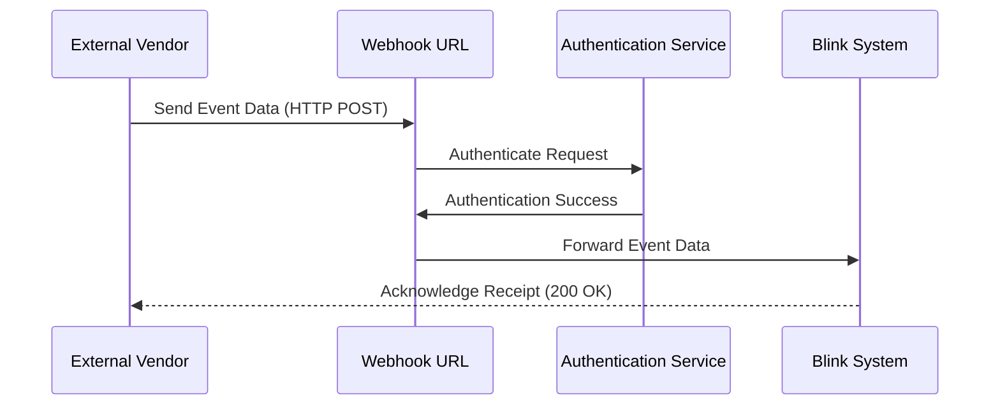

> ## Documentation Index
> Fetch the complete documentation index at: https://docs.blinkops.com/llms.txt
> Use this file to discover all available pages before exploring further.

# Using Webhooks

> Configure webhook-based triggers to start workflows when external events are received in Blink.

Webhooks enable real-time communication between applications, allowing Blink to receive event data instantly without polling. When an event occurs, the external vendor system sends an HTTP request to the webhook URL, triggering an automated workflow in Blink.

<Accordion title="Prerequisites" icon="list-check">
  Before configuring webhooks in Blink, ensure that:

  * The external vendor system supports webhooks and:
    * Can send HTTP POST requests.
    * Supports at least one of the following: API key or signature authentication.
  * You have:
    * Necessary permissions to create webhooks in the external vendor system.
    * A basic understanding of webhooks overall, and specifically of the webhook payload structure used by the external vendor system.
</Accordion>

## How Webhooks Work

Webhooks operate through HTTP POST requests when specific events occur.

The workflow follows these basic steps:

<Steps>
  <Step title="Send an HTTP POST Request">
    The external vendor system sends an HTTP POST request to the Blink webhook URL.
  </Step>

  <Step title="Authenticate the Request">
    Blink authenticates the request using an API key or signature.
  </Step>

  <Step title="Process the Event">
    If authentication succeeds, Blink processes the event and triggers the workflow.
  </Step>

  <Step title="Acknowledge Receipt">
    Blink acknowledges receipt, ensuring data integrity, and the next steps of the workflow are triggered if the necessary conditions are met.
  </Step>
</Steps>



<Card title="" icon="magnifying-glass-plus">
  <Accordion title="Example Use Case" icon="code-simple">
    Imagine you need to monitor activity in a GitHub repository and trigger a workflow when a new issue is created. You can use a webhook to listen for new issue events and trigger a workflow in Blink.

    Here's how you can set up a basic API key-authenticated webhook in GitHub to trigger a workflow in Blink:

    <Steps>
      <Step title="Create a new workflow">
        Create a new workflow in Blink and select **Event-Based Workflow**.
      </Step>

      <Step title="Select GitHub Connection">
        Choose the **GitHub** connection, select the **GitHub Webhook Event**, and click **Continue**.
      </Step>

      <Step title="Copy Webhook Details">
        Copy the **Webhook Full URL** and **API Key** provided by Blink.

        <Frame>
          
        </Frame>
      </Step>

      <Step title="Apply the Configuration">
        Click **Apply**.
      </Step>

      <Step title="Create Webhook in GitHub">
        In GitHub, go to the repository settings and create a new webhook.

        * Paste the **Webhook URL** in the **Payload URL** field.
        * In the **Secret** field, paste the **API Key** provided by Blink.
        * Select the events you want to trigger the webhook (e.g., **Issues**).
        * Click **Add webhook** to save the configuration.
      </Step>
    </Steps>

    When a new issue is created in the GitHub repository, GitHub sends an HTTP POST request to the webhook URL provided by Blink. Following is an example of the payload sent by GitHub:

    <Accordion title="Git Payload Example" icon="code-simple">
      ```sh theme={"dark"}
      {
          "hook": {
              "active": true,
              "config": {
                  "content_type": "form",
                  "insecure_ssl": "0",
                  "secret": "********",
                  "url": "https://blinkappdev-app.blinkops.com/webhooks/b7b90d07-0a10-498e-879d-0cad973a262c?apikey=9c4654dc04c046fd965sdkljf8977212ba"
              },
              "created_at": "2025-02-27T18:40:02Z",
              "deliveries_url": "https://api.github.com/repos/mygithubuser/myawesomerepo/hooks/532494700/deliveries",
              "events": [
                  "push"
              ],
              "id": 532494700,
              "last_response": {
                  "code": null,
                  "message": null,
                  "status": "unused"
              },
              "name": "web",
              "ping_url": "https://api.github.com/repos/mygithubuser/myawesomerepo/hooks/532494700/pings",
              "test_url": "https://api.github.com/repos/mygithubuser/myawesomerepo/hooks/532494700/test",
              "type": "Repository",
              "updated_at": "2025-02-27T18:40:02Z",
              "url": "https://api.github.com/repos/mygithubuser/myawesomerepo/hooks/532494700"
          },
          "hook_id": 532494700,
          "repository": {
              "allow_forking": true,
              "archive_url": "https://api.github.com/repos/mygithubuser/myawesomerepo/{archive_format}{/ref}",
              "archived": false,
              "assignees_url": "https://api.github.com/repos/mygithubuser/myawesomerepo/assignees{/user}",
              "blobs_url": "https://api.github.com/repos/mygithubuser/myawesomerepo/git/blobs{/sha}",
              "branches_url": "https://api.github.com/repos/mygithubuser/myawesomerepo/branches{/branch}",
              "clone_url": "https://github.com/mygithubuser/myawesomerepo.git",
              "collaborators_url": "https://api.github.com/repos/mygithubuser/myawesomerepo/collaborators{/collaborator}",
              "comments_url": "https://api.github.com/repos/mygithubuser/myawesomerepo/comments{/number}",
              "commits_url": "https://api.github.com/repos/mygithubuser/myawesomerepo/commits{/sha}",
              "compare_url": "https://api.github.com/repos/mygithubuser/myawesomerepo/compare/{base}...{head}",
              "contents_url": "https://api.github.com/repos/mygithubuser/myawesomerepo/contents/{+path}",
              "contributors_url": "https://api.github.com/repos/mygithubuser/myawesomerepo/contributors",
              "created_at": "2021-01-03T18:41:54Z",
              "default_branch": "dependabot/npm_and_yarn/types/node-14.14.16",
              "deployments_url": "https://api.github.com/repos/mygithubuser/myawesomerepo/deployments",
              "description": null,
              "disabled": false,
              "downloads_url": "https://api.github.com/repos/mygithubuser/myawesomerepo/downloads",
              "events_url": "https://api.github.com/repos/mygithubuser/myawesomerepo/events",
              "fork": false,
              "forks": 0,
              "forks_count": 0,
              "forks_url": "https://api.github.com/repos/mygithubuser/myawesomerepo/forks",
              "full_name": "mygithubuser/myawesomerepo",
              "git_commits_url": "https://api.github.com/repos/mygithubuser/myawesomerepo/git/commits{/sha}",
              "git_refs_url": "https://api.github.com/repos/mygithubuser/myawesomerepo/git/refs{/sha}",
              "git_tags_url": "https://api.github.com/repos/mygithubuser/myawesomerepo/git/tags{/sha}",
              "git_url": "git://github.com/mygithubuser/myawesomerepo.git",
              "has_discussions": false,
              "has_downloads": true,
              "has_issues": true,
              "has_pages": true,
              "has_projects": true,
              "has_wiki": true,
              "homepage": null,
              "hooks_url": "https://api.github.com/repos/mygithubuser/myawesomerepo/hooks",
              "html_url": "https://github.com/mygithubuser/myawesomerepo",
              "id": 326476666,
              "is_template": false,
              "issue_comment_url": "https://api.github.com/repos/mygithubuser/myawesomerepo/issues/comments{/number}",
              "issue_events_url": "https://api.github.com/repos/mygithubuser/myawesomerepo/issues/events{/number}",
              "issues_url": "https://api.github.com/repos/mygithubuser/myawesomerepo/issues{/number}",
              "keys_url": "https://api.github.com/repos/mygithubuser/myawesomerepo/keys{/key_id}",
              "labels_url": "https://api.github.com/repos/mygithubuser/myawesomerepo/labels{/name}",
              "language": "TypeScript",
              "languages_url": "https://api.github.com/repos/mygithubuser/myawesomerepo/languages",
              "license": {
                  "key": "mit",
                  "name": "MIT License",
                  "node_id": "MDc6TGljZW5zZTEz",
                  "spdx_id": "MIT",
                  "url": "https://api.github.com/licenses/mit"
              },
              "merges_url": "https://api.github.com/repos/mygithubuser/myawesomerepo/merges",
              "milestones_url": "https://api.github.com/repos/mygithubuser/myawesomerepo/milestones{/number}",
              "mirror_url": null,
              "name": "myawesomerepo",
              "node_id": "MDEwOlJlcG9zaXRvcnkzMjY0NzY2NjY=",
              "notifications_url": "https://api.github.com/repos/mygithubuser/myawesomerepo/notifications{?since,all,participating}",
              "open_issues": 19,
              "open_issues_count": 19,
              "owner": {
                  "avatar_url": "https://avatars.githubusercontent.com/u/13101827?v=4",
                  "events_url": "https://api.github.com/users/mygithubuser/events{/privacy}",
                  "followers_url": "https://api.github.com/users/mygithubuser/followers",
                  "following_url": "https://api.github.com/users/mygithubuser/following{/other_user}",
                  "gists_url": "https://api.github.com/users/mygithubuser/gists{/gist_id}",
                  "gravatar_id": "",
                  "html_url": "https://github.com/mygithubuser",
                  "id": 13101827,
                  "login": "mygithubuser",
                  "node_id": "MDQ6VXNlcjEzMTAxODI3",
                  "organizations_url": "https://api.github.com/users/mygithubuser/orgs",
                  "received_events_url": "https://api.github.com/users/mygithubuser/received_events",
                  "repos_url": "https://api.github.com/users/mygithubuser/repos",
                  "site_admin": false,
                  "starred_url": "https://api.github.com/users/mygithubuser/starred{/owner}{/repo}",
                  "subscriptions_url": "https://api.github.com/users/mygithubuser/subscriptions",
                  "type": "User",
                  "url": "https://api.github.com/users/mygithubuser",
                  "user_view_type": "public"
              },
              "private": false,
              "pulls_url": "https://api.github.com/repos/mygithubuser/myawesomerepo/pulls{/number}",
              "pushed_at": "2023-01-07T22:52:28Z",
              "releases_url": "https://api.github.com/repos/mygithubuser/myawesomerepo/releases{/id}",
              "size": 32926,
              "ssh_url": "git@github.com:mygithubuser/myawesomerepo.git",
              "stargazers_count": 0,
              "stargazers_url": "https://api.github.com/repos/mygithubuser/myawesomerepo/stargazers",
              "statuses_url": "https://api.github.com/repos/mygithubuser/myawesomerepo/statuses/{sha}",
              "subscribers_url": "https://api.github.com/repos/mygithubuser/myawesomerepo/subscribers",
              "subscription_url": "https://api.github.com/repos/mygithubuser/myawesomerepo/subscription",
              "svn_url": "https://github.com/mygithubuser/myawesomerepo",
              "tags_url": "https://api.github.com/repos/mygithubuser/myawesomerepo/tags",
              "teams_url": "https://api.github.com/repos/mygithubuser/myawesomerepo/teams",
              "topics": [],
              "trees_url": "https://api.github.com/repos/mygithubuser/myawesomerepo/git/trees{/sha}",
              "updated_at": "2021-01-03T18:48:03Z",
              "url": "https://api.github.com/repos/mygithubuser/myawesomerepo",
              "visibility": "public",
              "watchers": 0,
              "watchers_count": 0,
              "web_commit_signoff_required": false
          },
          "sender": {
              "avatar_url": "https://avatars.githubusercontent.com/u/13101827?v=4",
              "events_url": "https://api.github.com/users/mygithubuser/events{/privacy}",
              "followers_url": "https://api.github.com/users/mygithubuser/followers",
              "following_url": "https://api.github.com/users/mygithubuser/following{/other_user}",
              "gists_url": "https://api.github.com/users/mygithubuser/gists{/gist_id}",
              "gravatar_id": "",
              "html_url": "https://github.com/mygithubuser",
              "id": 13101827,
              "login": "mygithubuser",
              "node_id": "MDQ6VXNlcjEzMTAxODI3",
              "organizations_url": "https://api.github.com/users/mygithubuser/orgs",
              "received_events_url": "https://api.github.com/users/mygithubuser/received_events",
              "repos_url": "https://api.github.com/users/mygithubuser/repos",
              "site_admin": false,
              "starred_url": "https://api.github.com/users/mygithubuser/starred{/owner}{/repo}",
              "subscriptions_url": "https://api.github.com/users/mygithubuser/subscriptions",
              "type": "User",
              "url": "https://api.github.com/users/mygithubuser",
              "user_view_type": "public"
          },
          "zen": "Encourage flow."
      }
      ```
    </Accordion>
  </Accordion>
</Card>

## Authentication Methods

Webhook requests in Blink support two authentication methods:

* [API Key Authentication](#api-key-authentication)
* [Signature Authentication](#signature-authentication)

### API Key Authentication

This method allows the external service to execute the webhook using a static API key provided by Blink.

When an external service wants to trigger an event or send data to your application, it can do so by calling <Tooltip tip="the URL provided by Blink">the webhook endpoint</Tooltip>. To ensure that only authorized services can trigger this webhook, an API key is used. The API key acts as a secret token that the external service must include in its request to authenticate itself. If the API key is valid, the webhook is executed, and the desired action is executed.

<Accordion title="More About API Key Authentication" icon="magnifying-glass-plus">
  <Steps>
    <Step title="Retrieve the API Key">
      The API key is provided in the webhook configuration screen. The external service must include this key in its request to authenticate.
    </Step>

    <Step title="Send the Request with the API Key">
      The external vendor system sends an HTTP POST request to the webhook URL with the API key included in the request header. The request is typically sent using `curl` and may be similar to one of the following examples:

      ```sh theme={"dark"}
      curl -X POST https://<sub-domain>.app.blinkops.com/webhooks/<path>?apikey=<apikey>
      ```

      ```sh theme={"dark"}
      curl -X POST https://<sub-domain>.app.blinkops.com/webhooks/<path> -H "BLINK-API-KEY: <apikey>"
      ```

      Where:

      * `<sub-domain>` is the Blink instance base URL subdomain.
      * `<path>` is the specific webhook trigger path.
      * `<apikey>` is the API key provided by Blink.
    </Step>
  </Steps>
</Accordion>

### Signature Authentication

For each request, the external vendor system generates a cryptographic signature to verify that the request is genuine. This signature is included in the request and verified by Blink to ensure the request's integrity and authenticity. Unlike API Key authentication, the API key is **not** sent in the request. Instead, it is used to **generate a unique signature** for each request.

Signature authentication provides several benefits:

* **Prevents spoofing** – Ensures that only legitimate sources send webhook data.
* **Guards against tampering** – Verifies that the payload wasn’t modified in transit.
* **Adds an extra security layer** – Unlike API keys, which can be reused, signatures are unique to each request, making replay attacks difficult.

<Accordion title="More About Signature Authentication" icon="magnifying-glass-plus">
  <Steps>
    <Step title="Provide the API Key">
      The API key is provided to the external vendor system when configuring the webhook.
    </Step>

    <Step title="Generate a Signature for Each Request">
      The external vendor system generates the HMAC-SHA256 signature using the API key as the secret and the request components. The signature is generated using the following format:

      ```sh theme={"dark"}
      <timestamp>.<webhook URL>.<request body>
      ```

      The external vendor system computes an **HMAC-SHA256 hash** using the API key as the secret:

      ```sh theme={"dark"}
      SIG=$(echo -n "$TS.$URL.$BODY" | openssl dgst -sha256 -hmac "<API_KEY>")
      ```

      The external vendor system attaches the generated signature in the request header:

      ```sh theme={"dark"}
      X-BLINK-SIGNATURE: ts=<timestamp>;sig1=<hmac>
      ```
    </Step>

    <Step title="Send the Request with the Signature">
      The external vendor system includes the signature in the request header when sending the HTTP POST request to the webhook URL. The request is typically sent using `curl` and may be similar to the following example:

      ```sh theme={"dark"}
      TS=$(date +%s)
      BODY='{"event": "example"}'
      URL="https://<sub-domain>.app.blinkops.com/webhooks/<path>"
      SIG=$(echo -n "$TS.$URL.$BODY" | openssl dgst -sha256 -hmac "<API_KEY>")

      curl -X POST "$URL" -H "X-BLINK-SIGNATURE: ts=$TS;sig1=$SIG" -d "$BODY"
      ```

      Where:

      * `<TS>` is the current Unix timestamp at the time of the request.
      * `<URL>` is the full webhook endpoint URL, including the scheme (`https://`).
      * `<BODY>` is the raw JSON payload containing the event data.
      * `<SIG>` is the cryptographic signature generated using HMAC-SHA256.
      * `<API_KEY>` is the secret key used to compute the HMAC-SHA256 signature.
      * `<sub-domain>` is the Blink instance's subdomain (e.g., `yourcompany.app.blinkops.com`).
      * `<path>` is the specific webhook trigger path assigned in Blink.
    </Step>
  </Steps>
</Accordion>

### Best Practices

When configuring your workflow, consider validating payloads to ensure they match expected structures. This helps prevent malformed or malicious payloads from triggering the workflow and prevents errors when the workflow runs.

## Configure a Webhook

There are two ways to configure a webhook for Blink:

* Using the webhook event configured for a specific [external vendor](/docs/workflows/building-workflows/connections/connections)
* Creating a custom webhook trigger: Useful when the relevant connection is not pre-configured in Blink.

<Warning>
  The source platform must support webhooks to create a webhook trigger. If you are creating a custom webhook for your workflow, double check with the source platform to ensure that webhooks are supported.
</Warning>

**To configure a webhook trigger:**

1. [Create a new workflow](/docs/workflows/creating-a-workflow) and select **Event-Based Workflow**.

   <Frame>
     
   </Frame>

2. Click **Click to select an event** to open the **Trigger Setup** popup.

   <Frame>
     
   </Frame>

3. Select a connection from the list and choose the relevant webhook event. If the connection isn't currently supported by Blink, select **Custom Webhook**, then click **Apply**.

   <Frame>
     
   </Frame>

   Following is a description of the fields displayed in the **Trigger Setup** popup:

   <div className="integrations-table">
     | Field | Description |
     | - | - |
     | **Webhook Event Name** | The name assigned to the webhook event. By default, the **Webhook Event Name** is automatically set based on the connection you selected. You can modify this name to make it more descriptive. For example, *Webhook: Retrieve All Events*. |
     | **Authentication Method** | The authentication type used: **API Key** or **Signature** authentication. |
     | **Webhook Full URL** | The **complete URL** where events are sent. If using **API Key Authentication**, this URL includes the API key as a query parameter, and the external vendor system must send requests to this **exact URL**. No additional authentication headers are required. This field is not displayed when you choose the **Signature** authentication method. |
     | **Webhook Base URL** | The **core webhook endpoint** without query parameters. This is used for **Signature Authentication**, where the external vendor system generates a cryptographic signature before sending requests. |
     | **Webhook API Key** | The API key used for authentication. This is only applicable when using **API Key Authentication** and is embedded in the **Webhook Full URL**. |
     | | |
   </div>

   **API Key** is selected as the authentication method. The **Webhook Event Name**, **Webhook API Key**, **Webhook Full URL**, and **Webhook Base URL** are displayed in their respective fields.

4. *Optionally*, choose **Signature** for the authentication method.

   <Frame>
     
   </Frame>

   The **Webhook Base URL** and **Webhook API Key** are generated and displayed in their respective fields.

5. Copy the automatically generated details and save them. You'll need these to configure the webhook in the external vendor system.

   <Note>
     Notice that the Full URL contains the API key embedded in it. Whereas, the Base URL is only the link to the endpoint. Use the Base URL when embedding the key in the header.
   </Note>

   <Frame>
     
   </Frame>

6. *Optionally*, click **Add condition** to define additional trigger conditions.

   <Frame>
     
   </Frame>

7. Now, get Blink ready to listen for a test event:

   a. Next to **Sample Event**, click **View**.

   The **Sample Webhook Event** popup opens.

   <Frame>
     
   </Frame>

   b. Click **Listen to event** to start listening for events.

8. Go to the external vendor system:

   a. Configure the webhook, providing the webhook URL and API key in the relevant fields.

   <Tip>
     The field in the external vendor system might be called Secret, Token or something similar.
   </Tip>

   b. Send a test event to verify that Blink receives it.

   <Note>
     In order for the test event to be accepted by Blink, you must first trigger the listening, as explained in the previous step.
   </Note>

9. From Blink, watch the **Sample Webhook Event** window for the payload to load.
   When the event arrives, Blink captures and analyzes the payload.

10. Click **Apply** to confirm the detected schema and close the sample popup. Click **Apply** again to complete the configuration and close the **Trigger Setup** popup.

    <Frame>
      
    </Frame>

## See It In Action

Watch a demo of custom webhook creation:

<iframe src="https://demo.arcade.software/flRIJ2w2ezVRAztqevQC?embed&show_copy_link=true" title="Creating an Automation based on an Event from an External Service Provider" frameborder="0" loading="lazy" allowfullscreen className="iframe-webhook" width="100%" height="420" />

<Tip>
  The demo shows custom webhook configuration - but the flow is the same as when configuring a webhook for one of our predefined integrations (connections)!
</Tip>

## Related Articles

<CardGroup cols={3}>
  <Card title="Creating a Workflow" icon="plus" href="/docs/workflows/creating-a-workflow">
    Learn how to create and configure workflows in BlinkOps.
  </Card>

  <Card title="Using the Condition Builder" icon="code-fork" href="/docs/blink-platform/interface-components/condition-builder">
    Add advanced logic to your workflows.
  </Card>

  <Card title="Event-Based Triggers" icon="bolt" href="/docs/workflows/building-workflows/triggers/event-based-triggers/event-based-triggers">
    Explore how event-based triggers work and how to configure them.
  </Card>
</CardGroup>


This documentation is built and hosted on [Mintlify](https://mintlify.com), a developer documentation platform.