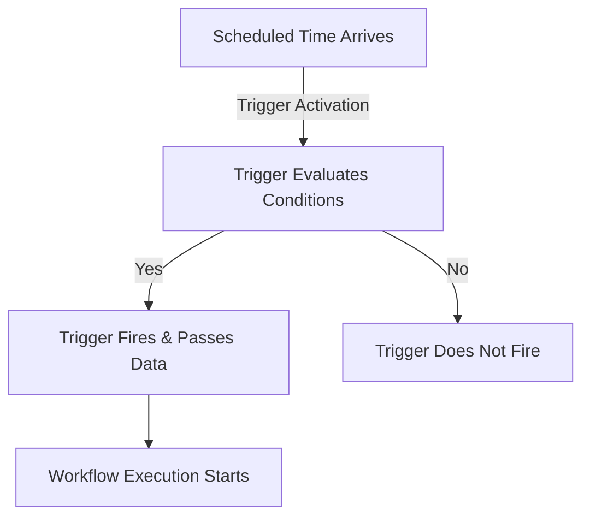

> ## Documentation Index
> Fetch the complete documentation index at: https://docs.blinkops.com/llms.txt
> Use this file to discover all available pages before exploring further.

# Using Scheduled Triggers

> Set up scheduled triggers to run Blink workflows automatically at specified times or intervals.

<Card title="How this Helps" icon="lightbulb">
  By selecting a scheduled trigger, users ensure that workflows execute automatically at the desired frequency without requiring manual intervention.
</Card>

A **scheduled trigger** initiates a workflow at a time and recurrence based on your configurations. Workflows can run at fixed intervals (**hourly, daily, weekly, or monthly**) or on a **custom schedule** using [<Tooltip tip="A string format used to define time-based schedules.">Cron Expressions</Tooltip>](https://en.wikipedia.org/wiki/Cron) for advanced flexibility. Scheduled triggers are essential for automating routine tasks, such as generating reports, performing system checks, or executing recurring processes.

<Tip>
  Scheduling triggers are great for managing tasks during business hours or off-peak times.
</Tip>

<Note>
  Need help finding the right trigger type for your use case? See [About Triggers](/docs/workflows/building-workflows/triggers/triggers).
</Note>

Users can configure schedules using:

  | Scheduling Method | Description |
  | - | - |
  | **Fixed Intervals** | Run workflows hourly, daily, weekly, or at custom time frames. |
  | **Cron Expressions** | Specify complex scheduling patterns using standard cron syntax. |

## How Scheduled Triggers Work

Scheduled triggers allow workflows to start automatically at predefined times or intervals, executing based on a fixed schedule. Scheduled triggers are ideal for routine automation tasks.

For example, IT admins can use scheduled triggers to automate daily system health checks, ensuring potential issues are identified and addressed promptly—without requiring manual intervention.

The following diagram illustrates how these triggers work:

<Steps>
  <Step title="A Scheduled Time Arrives">
    The trigger activates at the predefined time or interval, such as daily at 8 AM or every 15 minutes.
  </Step>

  <Step title="Trigger Conditions are Evaluated">
    If conditions are configured, Blink evaluates whether the conditions are met.
  </Step>

  <Step title="Trigger Fires & Passes Data">
    If the conditions are met, the trigger activates and passes relevant execution details, such as timestamps and scheduling metadata.
  </Step>

  <Step title="Workflow Executes">
    The associated workflow starts and runs the predefined automation tasks.
  </Step>
</Steps>

## Configuring a Scheduled Trigger

<Steps>
  <Step title="Start a New Scheduled Workflow">
    [Create a new workflow](/docs/workflows/creating-a-workflow) and choose the **Scheduled** trigger. You will be directed to the [workflow editor](/docs/workflows/building-workflows/workflow-editor).
  </Step>

  <Step title="Open the Schedule Settings">
    In the **Trigger** section, click **Click to schedule a run**. This opens the trigger configuration settings. Select "Every time period"

    <Frame>
      
    </Frame>
  </Step>

  <Step title="Set the Workflow Schedule">
    Define how often your workflow should run, and select the appropriate **time zone** for the schedule.
    <Tip>Your current time zone is selected by default.</Tip>

    You can choose from:

    * **Hourly**
    * **Daily**
    * **Weekly**
    * **Monthly**
    * **Custom** (advanced option using a Cron expression)

    If you select **Custom**, you can use the built-in **Cron Expression Picker** to create a precise schedule. It follows standard Cron syntax:

    

      | Symbol | Description |
      | - | - |
      | **\*** | any value |
      | **,** | value list separator |
      | **-** | range of values |
      | **/** | step values |
    

    <Note>
      **Important Scheduling Notes:**

      * **Default Interval:** Workflows run every **5 minutes** by default.
      * **Minimum Interval:** The shortest allowed schedule is **every 1 minute**.
      * **Performance Consideration:** Running workflows too frequently (e.g., every minute) can create unnecessary system load. Optimize these workflows for efficiency.
      * **Validation:** If the Cron expression is invalid, it will be highlighted in **red**.
    </Note>

    <Frame>
      
    </Frame>
  </Step>

  <Step title="Apply and Confirm the Schedule">
    Click **Apply** to save your scheduled time

    <Frame>
      
    </Frame>
  </Step>
</Steps>

***

## See It In Action

<iframe src="https://demo.arcade.software/6Dlibxjy15CwYclTgN8A?embed&show_copy_link=true" title="Creating a Scheduled Automation" frameborder="0" loading="lazy" allowfullscreen className="iframe-webhook" width="100%" height="420" />

## Related Articles

<CardGroup cols={3}>
  <Card title="About Triggers" icon="toggle-on" href="/docs/workflows/building-workflows/triggers/triggers">
    Learn how triggers automate workflow execution.
  </Card>

  <Card title="Creating a New Workflow" icon="plus" href="/docs/workflows/creating-a-workflow">
    Build and configure workflows from scratch.
  </Card>

  <Card title="Configuring Event-Based Triggers" icon="bolt" href="/docs/workflows/building-workflows/triggers/event-based-triggers">
    Set up triggers that start workflows based on events.
  </Card>

  <Card title="On-Demand Triggers" icon="user" href="/docs/workflows/building-workflows/triggers/on-demand-triggers">
    Manually start workflows whenever needed.
  </Card>
</CardGroup>

This documentation is built and hosted on [Mintlify](https://mintlify.com), a developer documentation platform.